[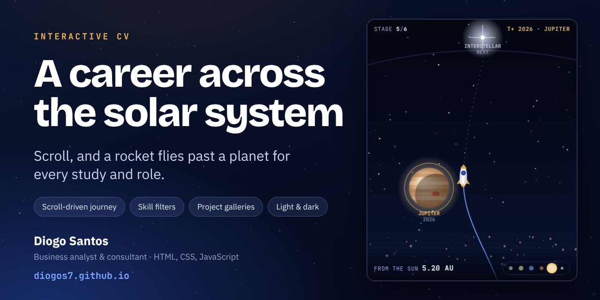](https://diogos7.github.io)

# Interactive CV

[](https://github.com/DiogoS7/DiogoS7.github.io/actions/workflows/check.yml)

My CV as a website: **[diogos7.github.io](https://diogos7.github.io)**

Scroll and a rocket flies out from Mercury, one planet per milestone, towards the next mission. Every planet is a milestone in my education or career. Pick a skill to see where I've used it, and open any project to browse its screenshots.

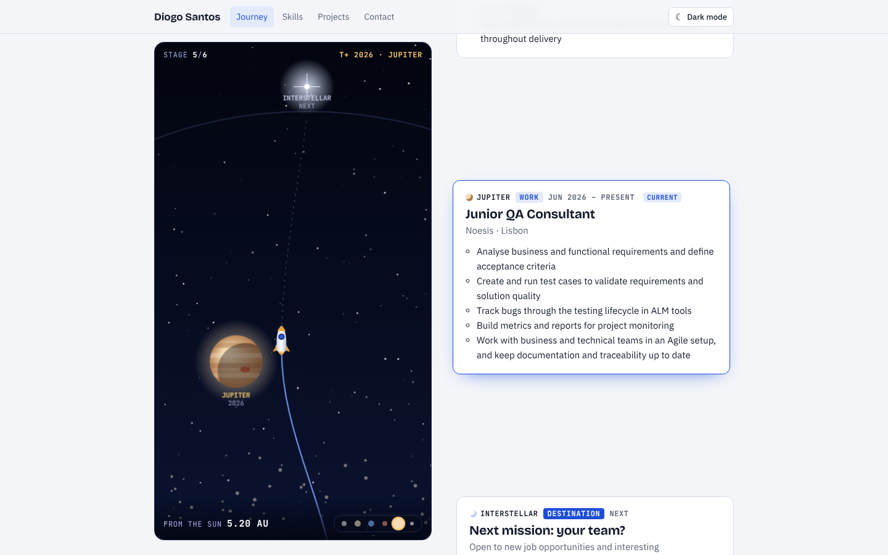

## Screenshots

| Header | Skills filter |
| --- | --- |
| 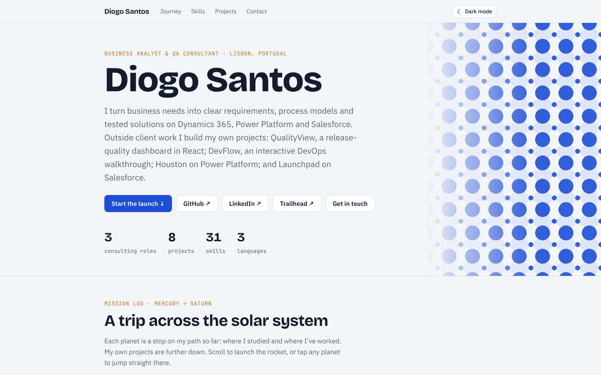 | 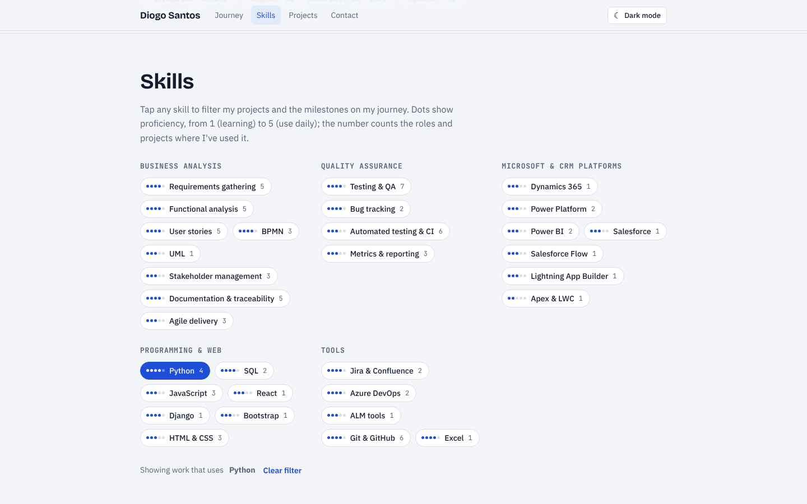 |

| Projects | Screenshot gallery |
| --- | --- |
| 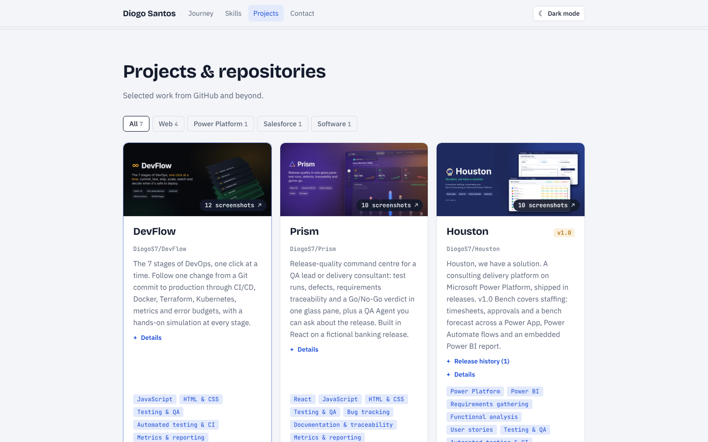 | 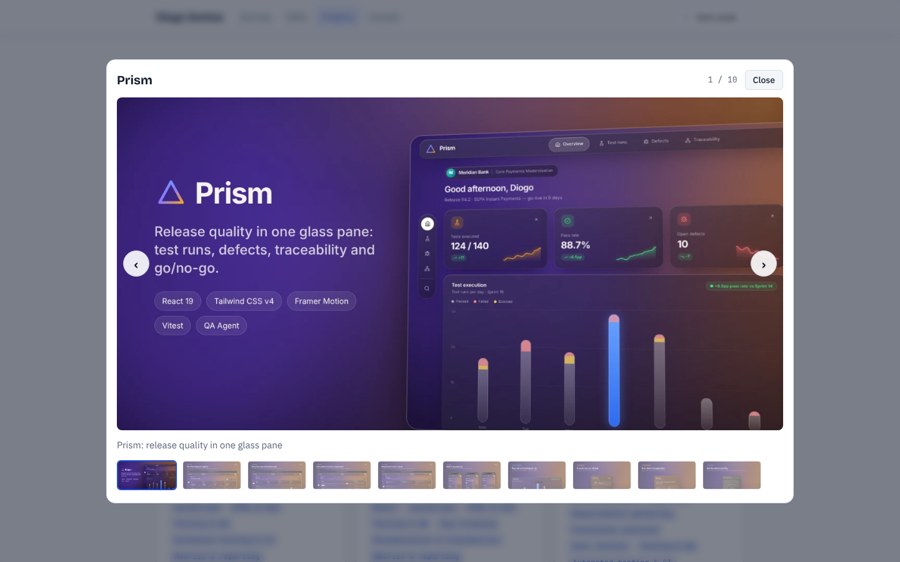 |

| Dark theme | Phone |
| --- | --- |
| 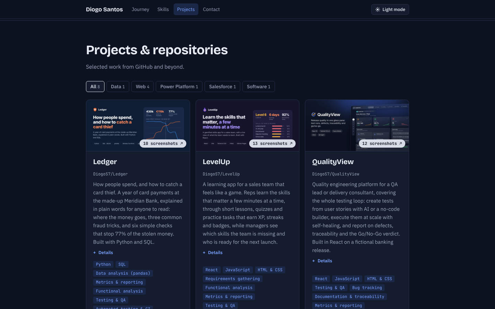 | 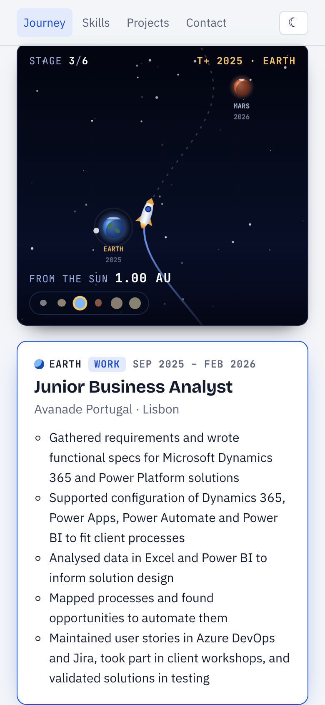 |

| Ask my CV | More on GitHub |
| --- | --- |
| 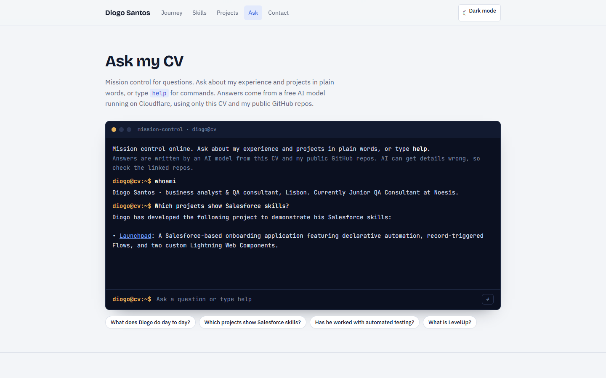 | 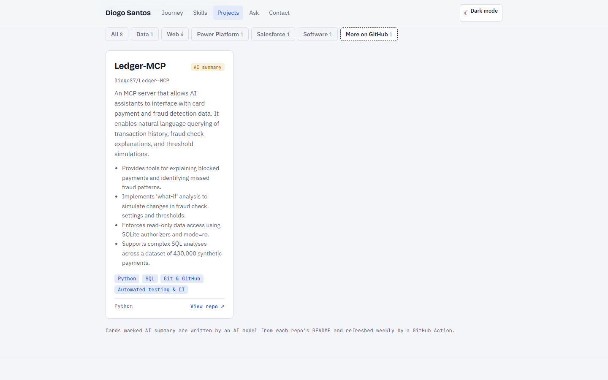 |

| Ask my CV, dark theme | Ask my CV on a phone |
| --- | --- |
| 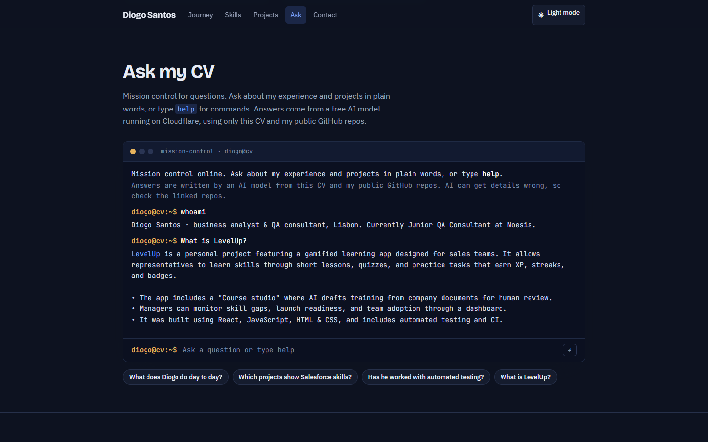 | 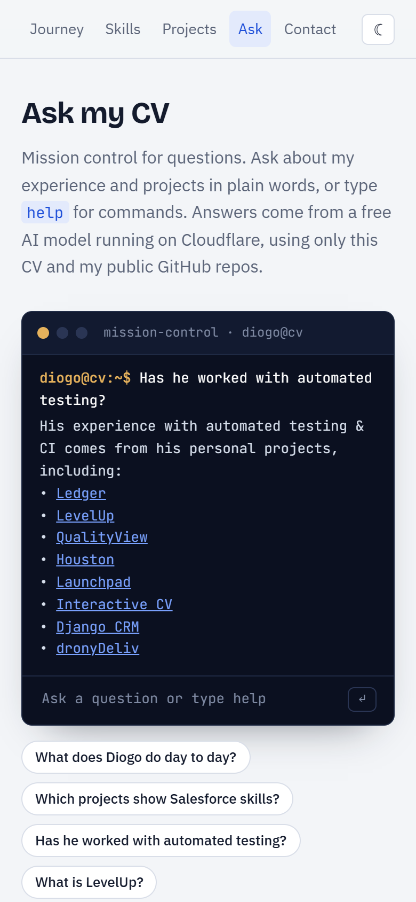 |

| More on GitHub on a phone | Ask my CV on a phone, dark theme |
| --- | --- |
| 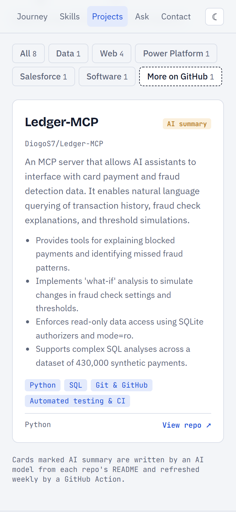 | 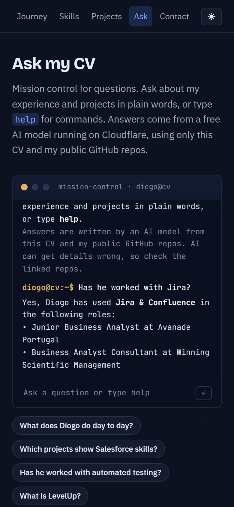 |

## Features

- **Solar-system journey**: a canvas animation tied to scroll. The rocket stops at one planet per milestone, with the year, stage and real distance from the Sun in AU. Tap a planet or a dot in the mini-map to jump to it.
- **Skill filters**: click any skill to highlight the projects and milestones that use it.
- **Screenshot galleries**: covers cycle through screenshots on hover; click for a gallery with arrows, thumbnails, keyboard and swipe.
- **Light and dark themes**, following the system setting, with a manual toggle.
- **Responsive** from phone to desktop. On phones the flight is pinned to the top of the screen.
- **Ask my CV**: a terminal where visitors ask about my experience in plain words. A free AI model on Cloudflare Workers AI answers from this CV and my public repos only, and links to the repo it got each answer from. Built-in commands (`help`, `ls`, `open ledger`, `cat skills`, `contact`) work without the AI.
- **Self-updating repo cards**: once a week a GitHub Action has the same free AI read the README of every public repo and write a short card for it. If anything changed, it opens a pull request for me to review. Repos not featured by hand appear under **More on GitHub**.
- **No frameworks, no build step.** Plain HTML, CSS and JavaScript, so GitHub Pages serves it as is.

## Project layout

```
index.html              page structure and link-preview tags
assets/css/styles.css   all styling, with light and dark colour tokens at the top
assets/js/data.js       ALL CV CONTENT: skills, projects, journey, languages, contact
assets/js/app.js        rendering, filters, gallery, theme toggle, solar-system flight
assets/js/ask.js        the Ask my CV terminal
assets/data/repos.json  repo cards written by scripts/index-repos.mjs (don't edit by hand)
scripts/index-repos.mjs reads every public repo's README and asks Workers AI for a card
worker/                 Cloudflare Worker that answers Ask my CV questions with Workers AI
assets/img/shots/       project screenshots shown on the site (WebP)
assets/img/og-image.png preview image used when the link is shared (1200×627)
docs/screenshots/       screenshots for this README
```

## Updating the CV

Almost every change happens in `assets/js/data.js`:

- **New job or course**: add an entry to `journey`, in date order. The planet is assigned automatically from its position, starting at Mercury.
- **New project**: add it to the top of `projects`, which runs newest release first. Give it `demo:"<url>"` to show a Live demo link next to View repo. Projects aren't stops on the journey, which is kept for education and work.
- **Releases**: a project shipped in versions (like Houston) gets a `releases` list instead of `shots`, newest first. Each release has a `version`, `name`, `date`, `url`, `summary`, `notes` and its own `shots`. The card and gallery open on the latest release, or on the one named in `featured` (for example `featured:"v1.0"`), and the gallery lets visitors switch between releases.
- **Screenshots**: save them as WebP in `assets/img/shots/` (about 1400px wide is plenty) and list them under the project's `shots`.
- **Skills**: add them to a group in `skills`, with a level from 1 to 5. Use the same name in a project's or milestone's `skills` so the filter finds it.

The last stop is always the open “Next mission: your team?” card, on the next planet out (Saturn today). Each new milestone goes just before it, so the next mission moves one planet further. The route runs Mercury to Neptune, then Pluto, Haumea, Makemake, Eris and Sedna, and interstellar space only appears once the journey has passed Neptune.

After editing any CSS or JS file, change the `?v=` number on its `<link>` or `<script>` tag in `index.html` (today's date works well). That makes visitors' browsers load the new version instead of a saved copy.

## Run it locally

Open `index.html` in a browser. Or serve the folder so paths behave exactly as on GitHub Pages:

```bash
python -m http.server 8000
# then open http://localhost:8000
```

## Ask my CV and the repo cards

Both run on **Cloudflare Workers AI on the free Workers plan**, so they cost nothing. The free plan has a daily allowance (10,000 "neurons" per day, reset at 00:00 UTC). Past it, requests fail until the next day, and nothing is ever charged; just don't upgrade to Workers Paid if you want to keep that guarantee. The model is set by `AI_MODEL` in `worker/wrangler.jsonc` (default `@cf/google/gemma-4-26b-a4b-it`), and any text-generation model in the [Workers AI catalog](https://developers.cloudflare.com/workers-ai/models/) works there.

**How the Worker answers.** `worker/src/knowledge.js` turns `data.js` and `repos.json` into a briefing that goes into the system prompt, and the model is told to answer only from it. Both files are bundled when the Worker deploys, so it always matches the site. Each answer is capped at 600 tokens, questions at 800 characters, conversations at the last 6 messages, and each visitor at 10 questions a minute. Only the origins in `ALLOWED_ORIGINS` (`worker/wrangler.jsonc`) can call it. Free models get details wrong more often than paid ones, so the terminal says so and every answer links to the repo it's based on.

### One-time setup

1. **Deploy the Worker** (needs a free Cloudflare account, no payment card):
   ```bash
   cd worker
   npm install
   npx wrangler login
   npx wrangler deploy
   ```
   Wrangler prints the Worker's URL, for example `https://cv-ask.<your-subdomain>.workers.dev`.
2. **Point the site at it.** In `assets/js/data.js`, set `askEndpoint: "https://cv-ask.<your-subdomain>.workers.dev/api/ask"` and push. Until this is set, the terminal still runs its built-in commands and says AI answers aren't switched on.
3. **Repository secrets** (Settings → Secrets and variables → Actions), used by both workflows:
   - `CLOUDFLARE_ACCOUNT_ID`: shown on the Cloudflare dashboard's Workers & Pages overview.
   - `CLOUDFLARE_API_TOKEN`: create one under My Profile → API Tokens from the *Edit Cloudflare Workers* template, and add the *Workers AI* permissions (Read and Edit) so the repo-card Action can use it too.
4. **Let Actions open pull requests**: Settings → Actions → General → Workflow permissions → tick *Allow GitHub Actions to create and approve pull requests*.

Workflows skip themselves with a notice until their secrets exist, so nothing fails before setup.

### Refreshing the repo cards

`.github/workflows/index-repos.yml` runs every Monday just after the daily allowance resets, or on demand from the Actions tab (tick *force* to rewrite every card). It only asks the AI about repos whose README, description or topics changed, and opens a pull request on `bot/repo-index` when there's something new, so you can fix any wording before it goes live. Pull requests opened by the Action don't start other workflows, so the checks run once you merge.

To run it yourself (Node 18 or later, no `npm install` needed):

```bash
node scripts/index-repos.mjs
```

It needs `CLOUDFLARE_ACCOUNT_ID` and `CLOUDFLARE_API_TOKEN` in the environment, and `GITHUB_TOKEN` helps avoid GitHub's rate limit (`GITHUB_TOKEN=$(gh auth token)`). Add `--no-ai` to refresh only the GitHub details.

### Trying the terminal locally

Run `npx wrangler dev` in `worker/` (Workers AI always runs on Cloudflare, so you need to be logged in, and local questions use the same free allowance), and temporarily set `askEndpoint` to `http://localhost:8787/api/ask` while serving the site on port 8000.

## Publishing

The repository is named `DiogoS7.github.io`, so GitHub Pages serves it at https://diogos7.github.io from the `main` branch. Every push to `main` updates the live site within a minute or two.

`.github/workflows/check.yml` runs on every push: it checks the JavaScript parses, the repo index is valid JSON, every image the site references exists, and the Worker bundles.

## License

[MIT](LICENSE) © Diogo Santos
